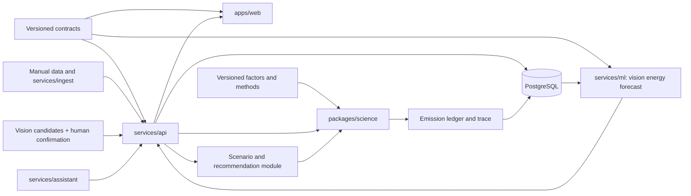

# Kickstart discovery and audit — 2026-11-02

Status: documentation foundations prepared; no product, trained models, production deployment, independent scientific sign-off or enforced GitHub permissions. User authorized the existing science guide and bundled reference in place of absent equations.md and identified Hassan as repository owner. Connected account is HassanG04; account plan is unknown.

## Discovery evidence
Initial inventory: 43 files, six directories: .github (including workflows), docs, members, prompts, reference. Read governing root docs, all six member charters, all eight prompts, architecture/contracts/security/science/model/validation/roadmap documents and relevant reference sections. No app, tests directory, package manifests, model artifacts, Git metadata or remote existed. All 42 manifest entries matched both byte count and SHA-256 before edits. No byte-identical Markdown duplicates were found. TASK.md did not exist; the user's kickstart request was the active brief.

The archive manifest is preserved as an extraction baseline, not a claim that edited files retain their old hashes. The original scientific reference remains byte-for-byte unchanged. New/edited paths are recorded in HANDOFF.md. The reference's historical verification labels are author claims, not independent verification by this audit.

## Scientific audit and proposed corrections
Use docs/scientific_engine.md for implementation guidance with this errata register. Do not promote the educational reference calculators directly into production. Methodology changes still require human science review and fixtures.

| ID / priority | Location and finding | Resolution / acceptance gate |
|---|---|---|
| SCI-A01 / P0 | Reference section 5.2 table says kg/TJ = g/MJ; carbon-content derivation gives kg/GJ while the table uses kg/TJ | 74,100 kg/TJ = 74.1 g/MJ; apply factor 1,000 when converting kg/GJ to kg/TJ. Test both paths produce the same mass. The science guide's fuel_t * NCV_GJ_per_t / 1000 * EF_kg_per_TJ is dimensionally correct. |
| SCI-A02 / P0 | Section 5.3 loss-adjusted electricity formula risks including end-user transmission losses in Scope 2 | University end-user losses belong separately in Scope 3 category 3 under the cited guidance; record generator/consumer and factor boundary. Never add losses already included in another factor. |
| SCI-A03 / P0 | Section 8.5 incorrectly calls net-zero CO2 cumulative net emissions reaching zero | Emissions balance removals over a defined period. Organizational allowance = user budget minus recorded emissions, with consistent period/boundary; it is not the global CO2 climate budget. |
| SCI-A04 / P0 | Contract measurement_status is unspecified; result states collapse user-reported and modeled inputs | Propose a versioned provenance model: MEASURED, USER_REPORTED, MODEL_ESTIMATED, FORECASTED, SCENARIO_SIMULATED, plus independent synthetic flag and per-input provenance. A calculated emission is not directly measured because its activity was measured. Production schema remains unchanged pending review. |
| SCI-A05 / P1 | Reference AR6 values include SF6 25,200 and HFC134a 1,526; retrieved GHG Protocol August 2024 table gives 24,300 and 1,530 | Reconcile original IPCC table/errata against the compilation; pin exact table, assessment, horizon and revision. Do not silently substitute either source. CH4 27/29.8 and N2O 273 agree with the retrieved table. |
| SCI-A06 / P1 | Section 4.1 claims replacing methane radiative efficiency alone gives 32.4 | With its own calculator and unchanged lifetime/enhancement, the result is 35.051942. Reconcile assumptions; arithmetic reproduction alone is not methodology validation. |
| SCI-A07 / P1 | Section 12 fuel calculator accepts negative mass; landfill recovery fraction >1 yields negative emissions | Validate finite values, supported units, fractions 0..1, valid periods and nonnegative activity; reject invalid inputs rather than silently clamp. |
| SCI-A08 / P1 | N2O-N examples use both 44/28 and 44.01/28.01 | Choose a versioned convention: 100 kg N2O-N *273 gives 42,900 vs 42,894.4305605 kgCO2e. Fix method tolerances and fixtures before implementation. |
| SCI-A09 / P1 | Refrigerant annual-loss model assumes charge maintenance; service-loss ambiguity | Separate operational leaks, replenishment, servicing and end-of-life recovery; require records or explicit estimates. Do not double count the same loss as leak and recharge. |
| SCI-A10 / P1 | Soil EF2 appears under a per-kg-N table despite an area-based equation | Treat as unresolved and excluded from MVP; verify denominator, magnitude and source before any agriculture implementation. |

Primary checks consulted 2026-11-02: [Scope 2 Guidance](https://ghgprotocol.org/sites/default/files/GHG%20Protocol%20Scope%202%20Guidance.pdf), [IPCC net-zero definition](https://www.ipcc.ch/report/ar6/wg1/chapter/chapter-1/), [GHG Protocol GWP compilation](https://ghgprotocol.org/sites/default/files/2024-08/Global-Warming-Potential-Values%20%28August%202024%29.pdf). The compilation also distinguishes fugitive fossil methane from combustion methane to avoid double-counting oxidation CO2; factor selection must encode the method/source category, not only the fuel name.

### Further scientific gates
- Scope 2 aggregate CO2e factors cannot yield invented CO2/CH4/N2O masses. Unknown gases remain unavailable, not zero. Location-based and market-based results are alternative views; contractual-instrument eligibility/quality needs validation before market-based reporting.
- No Egyptian or other national factor has been verified. Every real factor needs geography, effective reporting dates, publication/retrieval metadata, units, gas basis, verification status and immutable version.
- RGB images identify candidate equipment only. AC marketed HP, thermal capacity and electrical input power are distinct; watts-times-hours needs electrical input and explicit usage assumptions. No methane inference from imagery alone.
- Parent meter/bill and child device allocations are alternative representations; maintain deduplication and source lineage. Different organizations' overlapping scopes are not a global total.
- Forecast past and future periods must not overlap; use only data available at forecast time and explicit future factor scenarios. Forecast uncertainty differs from measurement/factor uncertainty.
- Scenario optimization must recompute interacting measures, preserve comfort/safety constraints, compare equal periods/boundaries and use tonnes for cost per tonne. Zero/nonpositive abatement does not have a useful ordinary MAC ranking.
- Independent relative-error propagation is an approximation; shared factors create correlations. Specify distributions, confidence level, covariance, zero-total behavior and Monte Carlo seed where used. Never relabel an arbitrary band as calibrated confidence.
- Process emissions require sector-specific activity and verified chemistry, separate from fuel combustion. Waste/agriculture/fugitive-process extensions are deferred.

## Architecture reconciliation and dependency map
Retain existing documented locations: apps/web, services/api, packages/science, services/ml, services/ingest, services/assistant, infra, docs, members, prompts. packages/contracts and tests are justified when executable schemas/tests arrive; create no empty trees now. Vision stays under services/ml/vision initially; optimization may start as an API module. No second apps/api or services/scientific-engine tree. These preserve existing boundaries; dedicated deployments remain contingent on actual load.

Science has no DB/network dependency. API owns identity, tenant enforcement, validation, orchestration and persisted lineage. Inference never writes the accounting ledger directly. Assistant tools use the same authorized API boundary. PostgreSQL is sufficient for the first slice; TimescaleDB, Redis, queues and accelerator workers are later options, not dependencies of the software-only demo. Temporary prototype has local fixtures and no persistence; the real vertical slice must persist to PostgreSQL.

## Ownership and dependency matrix — proposals pending team confirmation
| Member | Accountable component proposed | Required inputs / interface | Review boundary |
|---|---|---|---|
| Hassan_Gebril | API, schema/contracts, SaaS integration; scenario orchestration | Activities/factors, science results, versioned inference | Coordinates technical integration; user identified him as owner, human review still required |
| Ahmed_Shazly | Cloud/CI operations, ingestion, forecasting; site anomaly orchestration | Idempotent normalized activities, time history, model manifests | Adham supplies residual features; security reviews jobs/storage |
| Karim_Ayman | CV/OCR, equipment-state research, Gemini/RAG; recommendation explanations | VisionDetectionsV1 and tool schemas, user confirmation | Cannot auto-confirm inventory or make accounting decisions |
| Adham_Behery | Equipment energy estimation and experiment harness | EnergyEstimateV1, measured labels, schedule/context | Science baseline and grouped/temporal evaluation |
| Ziad_Kishk | Security policy, authorization review and adversarial tests | Auth/API/schema and assistant tools | Hassan implements platform integration; security owns policy/test acceptance |
| Ziad_Zeiny | Provisional fixture and QA maintenance | Reviewed equations, factor manifest, paired mentoring | Not sole scientific authority; skills assessment ZZ-000 first |

Science implementation lead and independent methodology reviewer remain to be named. Suggested division: Hassan integration, Ahmed factor provenance, Zeiny fixtures, expert science sign-off. Anomaly lead Ahmed with Adham support; optimization lead Hassan with Adham support; Karim owns explanatory interface. These clarify interfaces without asserting team acceptance.

## Research strategy — no experiments run
Every experiment requires objective, versioned input/output schema, dataset license/consent/hash, ground-truth source, preprocessing fitted on training data only, grouped/time split manifest, seed/config/environment lock, baseline, metrics, limitations and an artifact card. Confidence must be calibrated; training cost/resources require approval. Synthetic fixtures test behavior, never scientific accuracy.

| System / objective | Inputs -> outputs; dataset and ground truth | Preprocessing / baseline / proposed method | Training/evaluation and integration gates |
|---|---|---|---|
| Equipment detection: inventory completeness | Consented equipment images -> boxes/classes; human-labeled boxes | Resize/normalize; pretrained baseline; YOLO or RT-DETR fine-tuning | Site/camera holdout; mAP, recall, false positives; VisionDetectionsV1 candidates only; no power inference |
| Equipment state: useful operating-state evidence | Images/temporal observations -> on/off/unknown; synchronized verified state labels | Crop/time alignment; majority/manual baseline; classifier or temporal model | Device/site holdout, macro-F1/calibration; reject visually unobservable state; versioned state contract proposal |
| Specification extraction: reduce entry errors | Nameplates -> value/unit/evidence; human-transcribed fields | Crop/OCR/unit normalization; OCR+regex baseline; structured extraction | Manufacturer holdout, field F1 and unit error; OCR contract, human confirmation |
| Energy estimation: estimate missing kWh | Electrical ratings, schedule/context -> interval kWh; calibrated meter labels | Missingness, consistent intervals; watts-hours baseline; boosting, deep temporal model only if justified | Site/time holdouts, MAE/RMSE/bias/WAPE with zero guards, coverage; EnergyEstimateV1; measured vs allocated labels distinct |
| Forecasting: predict future energy/carbon | History/calendar/as-of weather -> future kWh and intervals; future meter readings | Causal lags; seasonal naive; boosting | Rolling-origin MAE/RMSE/MASE with constant-series guards and coverage; Prediction contract; carbon = energy * explicit factor scenario |
| Anomalies: detect actionable deviations | Meter residuals/context -> event scores; reviewed incident windows | Seasonal residuals; robust thresholds; isolation forest/boosting candidate | Time split, event precision/recall, alerts/day; missing-data alerts separate; anomaly contract proposed |
| Recommendations: prioritize feasible actions | Inventory/baselines/constraints -> ranked actions; expert relevance and measured outcomes | Rules baseline; ranker only with valid labels | Site holdout, ranking relevance, safety violations; causal savings require M&V; Recommendation contract |
| Optimization: find feasible scenarios | Baseline, actions, costs/comfort -> feasible plan and trade-offs; benchmark feasible solutions | Consistent periods/units; enumeration/greedy baseline; mathematical programming before ML | Compare objective/constraint violations/runtime on held-out scenarios; Simulation contract proposal; no validated savings claim |
| Optional disaggregation: attribute aggregate load | High-resolution aggregate + synchronized submeters -> per-load kWh | Align sampling/missingness; fixed-share baseline; temporal models | Appliance/building holdout, energy error/MAE/conservation; attribution contract proposal; never add to parent total |
| Gemini orchestration: grounded answers | Tenant queries + vetted retrieved passages/tools -> answer/citations; curated QA and tool traces | Retrieval/access filtering; template FAQ baseline; Gemini tool calling/RAG | Held-out groundedness, tool accuracy, leakage/injection, cost/latency; backend tools only; no model training prerequisite |

## Governance and repository status
Git initialized on unborn team/hassan-gebril; no commit, main ref, six branch refs or remote yet. Git and Python available; gh CLI absent. Connector authenticated HassanG04; scoped search returned no accessible CarbonMind repositories, not proof none exists. Connector lacks repository creation and plan/protection inspection capabilities. Do not create a different remote silently or infer private visibility.

The user's lowercase hyphenated member branches supersede legacy mixed-case underscore names. See repo.md for mapping and owner commands. Plan, five other GitHub handles, effective rules and non-owner negative tests remain unknown. Personal paid protection eligibility does not imply organization-specific branch push restrictions. CODEOWNERS is only a sample. See [GitHub protected branches](https://docs.github.com/en/repositories/configuring-branches-and-merges-in-your-repository/managing-protected-branches/about-protected-branches), checked 2026-11-02. No permissions enforcement is claimed.

## Validation evidence and limitations
Initial manifest: 42/42 exact matches. Original embedded CI document/link check passed locally. Eight spot checks covered 100 kWh ->45 kgCO2e; 120 W *10 h ->1.2 kWh ->0.54 kgCO2e; 5,000 L *2.68 ->13,400 kgCO2; 2 kg CH4 *27 ->54 kgCO2e; coal ->2440.68 kgCO2; precise N2O conversion ->42894.4305605; GWP-star ->-447. Factors are illustrative or reference values, not verified national standards. The first N2O expected value in the audit command was wrong; independent Decimal arithmetic corrected the harness. A console encoding failure was retried with UTF-8. Negative fuel and invalid recovery probes confirmed absent reference validation.

Reproduce the arithmetic checks with `python scripts/audit_reference.py`; it guards execution with the original reference hash and reports known negative-input failures as limitations. No application build, pytest suite, model training, migration, secret-scanner tool, hosted CI, tenant isolation, permissions or deployment test has run. The new docs check is only a document/reference integrity gate. It is not scientific certification or a security scanner. Final local verification is recorded in HANDOFF.md.

## Unresolved decisions
GitHub plan/organization versus personal hosting; collaborator handles; verified branch restrictions; production geography/year/factors/GWP source; pilot data consent; team role confirmation and science reviewer; deadline/capacity; production provenance schema; hosting budget and prototype visibility. Existing decisions.md is rationale; decision-log.md is the decision register. Avoid replacing either with duplicate policy prose.
